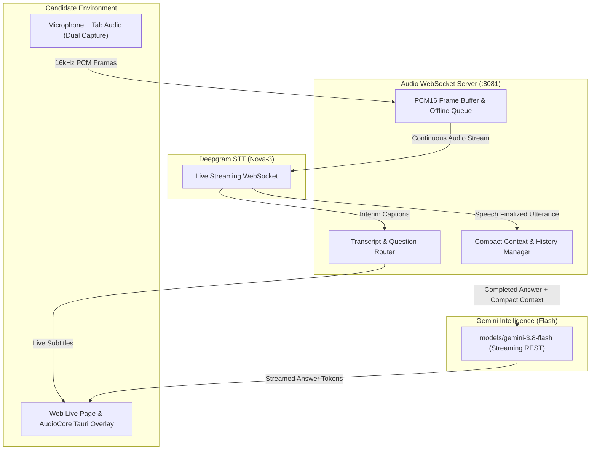

# Vren AI

**Live interview answers in your own words.** Vren AI listens to the interviewer and your microphone during a live interview, spots each question, and writes a short, first-person answer you can say out loud, grounded in your real CV and the job description. It also lets you practise beforehand, re-upload or update your CV anytime, and review each interview afterwards.

## What it does

- **Dual-channel live audio capture & waveform visualizer.** Captures both the interviewer's voice (meeting tab audio) and your microphone at the same time with a live dual-channel waveform and Voice Activity Detection (VAD) level meters.
- **Live answers grounded in your CV.** Questions are spotted from the interviewer's voice or screen. Each question gets a short, spoken-style answer in your first-person voice that streams in as it is written. You choose the length, the style, and a story format (STAR, CAR or SOAR). Figures and employers not in your CV are removed; if the AI is unavailable, Vren plainly displays `Answer unavailable`.
- **AudioCore Desktop Overlay (`Desktop app/`).** A lightweight Windows Tauri overlay that pairs via a 6-digit PIN code, mirrors live transcripts and streaming answers on top of your screen, supports click-through and custom opacity/font sizing, and uses Win32 `SetWindowDisplayAffinity(WDA_EXCLUDEFROMCAPTURE)` so the overlay stays hidden from screen sharing and recording.
- **CV management & re-upload.** Upload your CV during onboarding or replace/re-import it at any time from your Profile page (PDF, DOCX, TXT, or Markdown).
- **Coding questions and screenshots.** A coding question gets a spoken approach plus a concise code block. Paste a screenshot of a question and Vren reads it and answers.
- **Practice.** Run a mock interview for your target role: Vren asks the questions, you answer by typing or speaking, and it scores each answer, highlights what to improve, and drafts a stronger answer from your CV.
- **Review.** After each interview: what was asked, which job skills came up, how much of your CV was used, and an AI coaching summary on request.
- **Resilient AI fallback.** Uses **Gemini** (`GEMINI_API_KEY`) as primary and **OpenAI** (`OPENAI_API_KEY`) as automatic fallback.

## Real-time Interview Architecture



### Alternative: Gemini Live API Architecture

Vren AI implements a dual **Deepgram Nova-3 + Gemini Flash** pipeline, which is optimal when you need accurate real-time transcription, auditable interview logs, STAR/CAR/SOAR structured answer scoring, and fine-grained control over prompt context.

If you prefer a direct speech-to-speech interaction model without separate STT, you can alternatively switch to Google's **Gemini Live API** over WebSockets, which listens to native PCM and responds directly.

## How the pieces fit

```
 interviewer's voice (tab) + your mic                          you
        │                                                   ▲       ▲
        ▼                                                   │       │
 ┌──────────────┐  PCM16   ┌──────────────┐  WebSocket  ┌───┴───────┴────┐
 │ web app      │ ───────▶ │   backend    │ ──────────▶ │ Web Live Page  │
 │ dual capture │          │  speech→text │             │ + AudioCore    │
 │ + visualizer │          │  question    │             │ Tauri Overlay  │
 └──────────────┘          │  answer (AI) │             └────────────────┘
        ▲                  └──────────────┘
        └─────────────────────────┘  (CV, jobs, settings, practice, history, review)
```

## What is where

| Folder         | What it is                                                                                                                    | Start here                                    |
| -------------- | ----------------------------------------------------------------------------------------------------------------------------- | --------------------------------------------- |
| `src/`         | Web app (TanStack Start, React 19): CV profile, jobs, **Live interview**, **Practice**, history, settings                     | `src/routes/`                                 |
| `backend/`     | API (FastAPI, SQLAlchemy): speech-to-text, question detection, grounded answers, pairing, practice, review                    | `backend/app/modules/`                        |
| `Desktop app/` | AudioCore Tauri desktop overlay (React + Rust/Win32): PIN pairing, live answer stream, drag/close controls, capture exclusion | `Desktop app/src/` & `Desktop app/src-tauri/` |
| `docs/`        | Product requirements and design notes                                                                                         | [`docs/PRD.md`](docs/PRD.md)                  |

## Run it

You need Node 20+, [uv](https://docs.astral.sh/uv/), and Python 3.12+ (plus Rust & MSVC Build Tools on Windows if building the desktop overlay).

### 1. Web App & Backend API

```sh
npm install
cp backend/.env.example backend/.env       # then add your GEMINI_API_KEY / OPENAI_API_KEY
uv --directory backend sync
uv --directory backend run alembic upgrade head
npm run dev                                 # web on :5173, API on :8000
```

For a quick start without Postgres, set `DATABASE_URL=sqlite+aiosqlite:///./storage/vren_local.db` in `backend/.env`.

**Run `alembic upgrade head` again after every update.**

### 2. AudioCore Desktop Overlay (`Desktop app/`)

```sh
cd "Desktop app"
npm install
npm run dev                                 # run in dev mode
# or build standalone .exe / installer bundles:
npm run build
```

Built installers and executables are output to:

- `Desktop app/src-tauri/target/release/AudioCore.exe`
- `Desktop app/src-tauri/target/release/bundle/nsis/AudioCore_0.1.0_x64-setup.exe`
- `Desktop app/src-tauri/target/release/bundle/msi/AudioCore_0.1.0_x64_en-US.msi`

### Keys (`backend/.env`)

| You want                 | Set                                                                                                                        | How to obtain                                                                        |
| ------------------------ | -------------------------------------------------------------------------------------------------------------------------- | ------------------------------------------------------------------------------------ |
| Answers & Analysis       | `GEMINI_API_KEY` (primary) and/or `OPENAI_API_KEY` (fallback).                                                             | Get a free Gemini key from [Google AI Studio](https://aistudio.google.com).          |
| Real-time Speech-to-Text | `DEEPGRAM_API_KEY` with `STT_PROVIDER=deepgram` for real-time streaming, or reuses your OpenAI / Gemini key automatically. | Get API credits and a key from the [Deepgram Console](https://console.deepgram.com). |
| Audio WebSocket Port     | `AUDIO_WS_PORT=8081` (default: 8081).                                                                                      | Configurable port for the Node.js audio pipeline.                                    |

### Use it

1. Sign in, upload your CV (or update it anytime under **Profile → Replace CV**), and add a target job.
2. Open **Live interview** and press **Start**.
3. Copy the 6-digit pairing PIN into the **AudioCore Desktop App** and click **Sync to Interview**.
4. Click **Start Audio Capture (Meeting + Mic)** and select your meeting tab with **Share tab audio** enabled.
5. Questions and first-person answers stream live to both the web page and the desktop overlay. When done, end the session or click **Close Window** (`✕`) on the overlay.

## Tests

```sh
npm test                                    # web unit tests (Vitest)
uv --directory backend run pytest -q        # backend test suite (Pytest)
```
