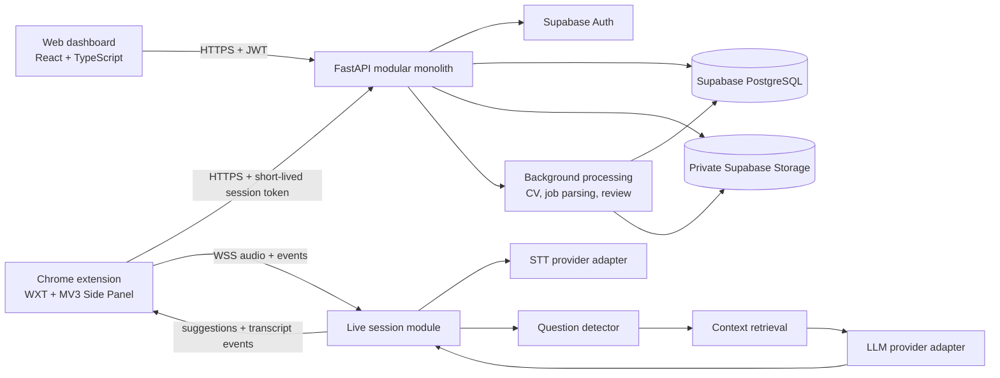
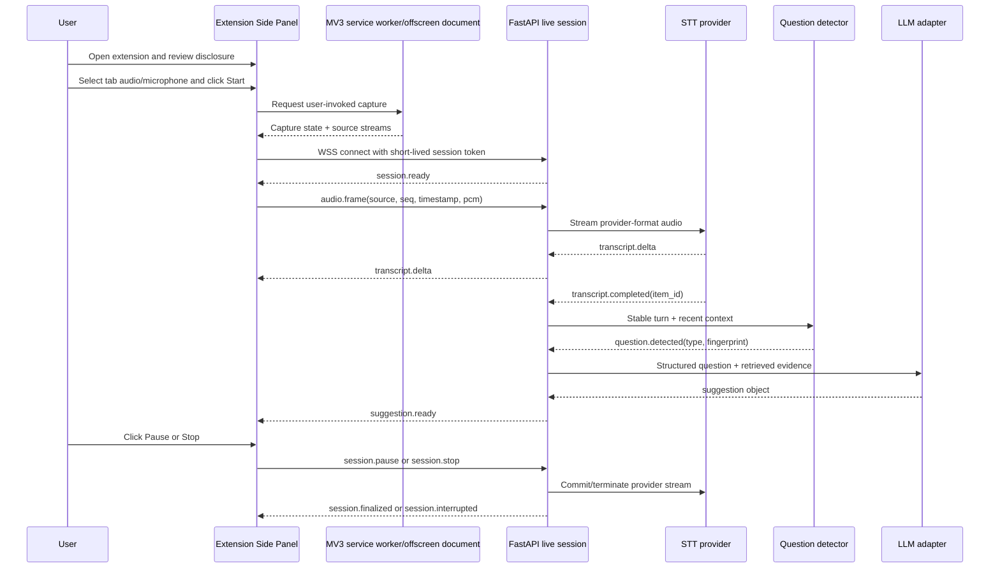
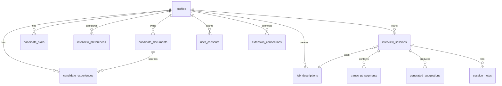

# Vren AI — Product Requirements Document

**Document status:** Draft for product and technical approval  
**Version:** 1.0  
**Product:** Vren AI  
**Author:** Manus AI  
**Last updated:** 10 November 2026  
**Primary interfaces:** Web dashboard and Google Chrome extension  
**Audience:** Product, design, frontend, extension, backend, AI, security, QA, and operations teams

---

## 1. Executive Summary

Vren AI is one connected product with two interfaces:

1. A web dashboard for account management, candidate context, job descriptions, interview preparation, session history, and review.
2. A Chrome extension that provides an explicit, user-controlled companion panel during supported browser-based interviews.

The product helps a candidate prepare for and navigate an interview by combining the candidate's structured professional context, the relevant job description, selected interview preferences, and the live interview conversation. It returns concise guidance rather than long text that is difficult to read while speaking.

The initial release must prioritise reliability, transparency, privacy, and useful latency over feature breadth. Vren AI must never fabricate a candidate's experience, qualifications, employment history, or achievements. It must not hide capture activity, bypass browser permissions, evade screen-sharing detection, or claim compatibility with every meeting platform.

The MVP will support:

- Secure account creation and sign-in.
- CV upload, extraction, review, and structured candidate context.
- Multiple job descriptions and reusable candidate profiles.
- Interview preferences and preparation configuration.
- Chrome Manifest V3 extension with a Side Panel interface.
- Explicit tab-audio capture and optional microphone capture as separate paths.
- Streaming transcription through a server-side provider adapter.
- Question detection, context retrieval, and concise structured suggestions.
- Session termination, consent-based transcript storage, notes, and review.
- Recovery from ordinary network and provider failures.

The recommended initial architecture is a React/TypeScript web application, a WXT/React/TypeScript Manifest V3 extension, a Python/FastAPI modular monolith, Supabase Auth/PostgreSQL/Storage, and a backend-owned WebSocket pipeline. Chrome's `tabCapture` API requires user invocation before capture begins, and tab audio is not automatically the candidate microphone. The product therefore treats permissions and capture paths as first-class workflow states. [1] [2]

---

## 2. Product Vision and Objectives

### 2.1 Vision

Vren AI should feel like a calm, professional interview workspace that helps a candidate think clearly without taking control away from them. The product should reduce preparation overhead, surface relevant evidence from the candidate's own background, and make live guidance short enough to use naturally.

### 2.2 Product objectives

| Objective | Measurement direction | MVP target |
|---|---|---|
| Make setup reusable | A candidate can reuse one profile across jobs | No repeated CV upload for each job |
| Make live assistance useful | Suggestions reference the active question and candidate context | At least 80% of evaluated suggestions are relevant in an internal benchmark |
| Keep guidance concise | Suggestions are scannable while speaking | Default answer guidance is 3–5 bullets or a short outline |
| Protect user control | Capture is visible, user-initiated, stoppable, and disclosed | Zero hidden capture paths in release testing |
| Protect sensitive data | Private content is isolated per user and deletable | RLS, signed URLs, deletion flows, and audit events pass security tests |
| Make sessions dependable | Connection and provider failures are recoverable | Session state is never silently marked complete after disconnect |
| Control operating cost | AI and transcription usage is bounded | Per-session quota, duration cap, and provider usage telemetry |

### 2.3 Non-objectives for MVP

The MVP will not include invisible or undetectable operation, screen-sharing evasion, desktop-wide audio capture, automatic capture of arbitrary native applications, candidate impersonation, automated speaking, coding execution, recruiter-side workflows, team administration, or a broad meeting-platform compatibility promise.

---

## 3. Problem Statement

Candidates often prepare with fragmented information: a CV in one location, a job description in another, and notes that are not available when a question is asked. Generic interview advice does not reliably connect an answer to the candidate's actual experience. During a live conversation, a candidate has little time to search for a relevant project, choose an answer framework, and organise a concise response.

Existing assistant concepts frequently fail in one of three ways:

- They generate polished but generic paragraphs that are too slow to read.
- They invent or overstate candidate experience.
- They obscure what is being captured and how data is used.

Vren AI addresses the problem with structured candidate context, question-aware retrieval, compact guidance, clear capture controls, and a review loop that lets the candidate correct extracted information.

### 3.1 Product principles

1. **Candidate truth over fluency.** If the system cannot support a claim from the candidate context, it must say so or ask the candidate to add evidence.
2. **Explicit control over convenience.** Capture starts only after an intentional user action and remains visibly controllable.
3. **Short guidance over long answers.** The assistant supplies talking points, structures, and evidence; it does not attempt to speak for the candidate.
4. **One product, two surfaces.** The dashboard and extension share identity, context, preferences, and session history.
5. **Graceful degradation.** If transcription or AI is unavailable, the extension explains the state and preserves the user's ability to stop safely.
6. **Privacy by default.** Raw audio is not retained by default. Transcript and note retention require clear user choice.

---

## 4. Target Users and Personas

### 4.1 Primary persona: Prepared candidate

A job seeker with one or more active applications who wants to prepare with their own CV and job-specific context. They value accuracy, concise prompts, and control over personal data. They may use the product several times per week.

**Needs:** reusable profile, job matching, practice questions, focused live prompts, safe storage, editable extracted data.

### 4.2 Secondary persona: Career changer

A candidate whose CV contains transferable skills but whose experience may not map directly to the target role. They need help identifying relevant evidence without the system inventing equivalence.

**Needs:** transferable-skill framing, explicit evidence gaps, configurable response style, prompts to clarify rather than fabricate.

### 4.3 Secondary persona: Technical candidate

A candidate attending technical interviews who needs a compact way to organise problem-solving steps, assumptions, trade-offs, and questions to ask.

**Needs:** technical interview mode, coding/problem-solving structure, domain terminology support, longer context window, no automatic code execution in MVP.

### 4.4 Accessibility and language considerations

The product must support keyboard navigation, reduced motion, screen-reader labels, readable contrast, resizable text in the extension, and user-selected response language. Initial launch language is English. Additional languages require evaluation of transcription quality, prompt safety, UI copy, and provider support rather than being enabled solely by configuration.

---

## 5. Product Scope

### 5.1 MVP scope

- Web authentication and account recovery.
- Candidate profile with one or more CV documents, structured extraction, and manual correction.
- Job description creation from pasted text or supported document upload.
- Job-context extraction and candidate/job comparison.
- Interview preparation configuration.
- Chrome extension installation, authentication connection, and Side Panel.
- Supported-tab detection and explicit audio disclosure.
- Tab audio capture using `tabCapture` after extension invocation.
- Optional microphone capture through a separate permission and state.
- Backend WebSocket session with bounded audio streaming.
- Streaming transcript display and question detection.
- Concise contextual suggestions with source evidence labels.
- Pause, resume, stop, reconnect, and safe session termination.
- Consent-based transcript and notes storage.
- Session review with questions, suggestions, strengths, improvement areas, and feedback.
- Operational metrics that avoid retaining unnecessary raw content.

### 5.2 Phase 2 scope

- Mock interview practice in the web application.
- More detailed post-session evaluation.
- Better speaker separation where provider support and legal review allow it.
- Personal question library and reusable answer evidence.
- Additional supported meeting surfaces after compatibility testing.
- Candidate-controlled correction feedback for extracted context.
- Optional live captions with richer transcript navigation.

### 5.3 Future possibilities

These must not delay the MVP:

- Mobile companion.
- Native desktop audio capture.
- Recruiter or coach collaboration.
- Organisation workspaces and billing administration.
- Automated application tracking.
- Voice output or auto-speaking.
- Multi-region processing guarantees.
- Automated code execution or screen understanding.

### 5.4 Compatibility boundary

MVP support is limited to Chrome desktop versions selected during release qualification and browser-based meeting tabs that expose capturable tab audio. Vren AI will not claim to capture audio from arbitrary desktop applications. A supported-surface matrix must be maintained separately from the product marketing page.

---

## 6. MVP and Feature Prioritisation

| Feature | Priority | User objective | MVP decision |
|---|---:|---|---|
| Authentication | P0 | Access the same account from web and extension | Include |
| Candidate profile and CV extraction | P0 | Avoid re-entering background information | Include |
| Job descriptions | P0 | Tailor guidance to a specific role | Include |
| Preparation configuration | P0 | Control answer style and length | Include |
| Extension Side Panel | P0 | Keep guidance beside the meeting tab | Include |
| Explicit capture controls | P0 | Understand and control data capture | Include |
| Tab audio capture | P0 | Hear interviewer audio on supported tabs | Include, subject to compatibility |
| Optional microphone capture | P0 | Add candidate audio when desired | Include as separate permission |
| Streaming transcription | P0 | Turn live audio into usable text | Include |
| Question detection | P0 | Avoid reacting to ordinary conversation | Include |
| Contextual suggestions | P0 | Organise a relevant answer quickly | Include |
| Reconnect and safe stop | P0 | Avoid silent session loss | Include |
| Transcript retention controls | P0 | Decide what remains after the session | Include |
| Post-session feedback | P1 | Learn from the interview | Include in lightweight form |
| Mock interviews | P1 | Practise before a real session | Phase 2 |
| Speaker diarization | P1 | Distinguish interviewer and candidate speech | Phase 2, provider-dependent |
| Automatic meeting-platform detection | P1 | Improve setup guidance | Phase 2 |
| Native desktop capture | P2 | Support non-browser interviews | Future |
| Auto-speaking | P2 | Respond on user's behalf | Out of scope |

For every P0 feature, a release build requires a happy-path acceptance test and at least one permission, provider, or network failure test.

---

## 7. Complete User Journeys and Workflows

### 7.1 Registration and onboarding

1. The user opens the Vren AI website and selects **Create account**.
2. The user enters email and password, or uses an enabled identity provider if one is approved for launch.
3. The backend validates the request, creates the account through Supabase Auth, and sends verification email.
4. Until verified, the user sees a clear verification state and can resend the email with rate limiting.
5. After verification, the user completes a short profile step: name, preferred language, and optional role focus.
6. The dashboard opens to **Prepare your first interview**, with actions to add a CV or continue without one.
7. The extension installation prompt appears only after the user has a candidate profile or explicitly chooses to connect the extension.
8. The user installs the extension from the Chrome Web Store, opens it manually, and chooses **Connect to Vren AI**.
9. The extension uses a short-lived connection flow. It does not receive provider secrets.
10. The dashboard records the extension connection timestamp and version, not browsing history.

**Failure states:** duplicate email, weak password, expired verification link, provider outage, extension not installed, extension version below minimum. Each state provides a next action and does not discard completed setup.

### 7.2 Candidate profile and CV processing

1. The user selects **Add CV** and chooses PDF or DOCX. The UI states file-size and page limits before selection.
2. The backend validates MIME type, extension, size, malware-scan status, and parsability before processing.
3. The file is stored in a private Supabase Storage path owned by the user.
4. A background job extracts text and converts it into structured fields: contact details, summary, roles, employers, dates, skills, projects, education, certifications, and evidence snippets.
5. The system marks each field with extraction confidence and source location where available.
6. The dashboard shows a review screen. The user can edit, delete, or add information before it becomes eligible for AI suggestions.
7. The system distinguishes **verified by user**, **extracted**, and **missing** information.
8. If extraction fails, the document remains available for deletion or replacement and the user can enter context manually.
9. The system stores the structured representation separately from the original document so it does not resend the raw CV on every live request.

**Rules:** empty fields are not inferred; dates are not normalised when ambiguous without showing the original; no achievement is generated from a job title alone.

### 7.3 Job description setup

1. The user selects **Add job** and chooses pasted text or a supported document.
2. The backend extracts responsibilities, required skills, preferred skills, seniority, domain terms, and likely interview themes.
3. The user reviews the extracted job context and can edit the canonical text or structured fields.
4. The system compares the job context with the selected candidate profile and displays matched evidence, partial matches, and gaps.
5. The job is saved independently from the CV and can be reused across sessions.
6. A job can be archived without deleting historical sessions that used it.

### 7.4 Interview preparation

The user selects:

- Candidate profile.
- Job description.
- Interview type: behavioural, technical, case, system design, general, or custom.
- Response language.
- Preferred answer length: brief, standard, or detailed.
- Response style: direct, conversational, structured, or coaching.
- Answer framework: STAR, problem/approach/trade-off, situation/decision/result, or none.
- Transcript retention choice and note preference.

The system produces a preparation summary showing the selected inputs, missing context, likely themes, and a **Start live session** action. These settings are copied into the session snapshot so later edits do not silently change historical session meaning.

### 7.5 Starting a live interview

1. The user opens a supported browser meeting tab.
2. The user manually opens the Vren AI extension from the toolbar or Side Panel.
3. The extension verifies the authenticated session and shows the active preparation context.
4. The extension explains: what tab audio is captured, whether microphone audio is enabled, where audio is sent, whether transcript storage is enabled, and how to stop.
5. The user selects tab audio, microphone, or both. These are separate controls and separate permission outcomes.
6. The user selects **Start session**. This click is the capture initiation gesture.
7. The extension requests or uses the required Chrome permission. If denied, the session remains stopped and explains the missing permission.
8. The extension establishes a backend WebSocket using a short-lived session token.
9. The extension sends a session configuration and waits for `session.ready`.
10. Audio frames begin only after the UI shows **Listening** and a visible stop control.
11. Transcript deltas appear in a compact live transcript area.
12. Completed turns are evaluated for question likelihood and type.
13. Relevant candidate/job evidence is retrieved and a concise suggestion is generated.
14. The extension shows the latest suggestion, confidence/coverage state, and evidence references such as “From your experience: project X.”

### 7.6 During the interview

The processing pipeline is:

1. Capture tab audio and, if selected, microphone audio separately.
2. Convert both sources to the backend's agreed PCM format or another provider-supported format.
3. Chunk frames with sequence number, source, timestamp, and session ID.
4. Apply backpressure. If the connection or provider cannot keep up, the extension shows a degraded state rather than buffering without bound.
5. Stream frames to the backend WebSocket.
6. Stream audio to the transcription adapter.
7. Reconcile partial and final transcript events by provider item ID and application sequence.
8. Run question detection only on stable transcript windows or completed turns, with a debounce and duplicate fingerprint.
9. Classify the question as behavioural, technical, case, clarification, follow-up, or unknown.
10. Retrieve only relevant structured candidate/job context.
11. Generate a response object with an answer outline, evidence, caveat, framework, and short follow-up.
12. Apply safety validation: unsupported claims are removed or marked as unsupported.
13. Stream the suggestion to the extension without blocking transcript rendering.
14. Preserve session state and event IDs for reconnect and idempotency.

The system must not generate a new suggestion for every partial transcript change. A new generation requires a completed or sufficiently stable question, a material text change, and no duplicate fingerprint within the configured window.

### 7.7 Pausing and stopping

- **Pause** stops audio transmission while keeping the session open for a short configurable grace period.
- **Resume** requires an explicit user action and returns to the disclosure state if permissions changed.
- **Stop** closes capture tracks, sends `session.stop`, closes provider and backend connections, and shows a finalisation state.
- Closing the meeting tab or extension triggers cleanup where detected, but the backend also expires inactive sessions.
- The UI must never imply that a session ended successfully until the backend acknowledges finalisation or records a recoverable interrupted state.

### 7.8 Ending and reviewing an interview

1. The user stops the session.
2. The extension closes capture tracks and sends the last sequence number.
3. The backend finalises transcript segments and queues post-session analysis.
4. Raw audio is discarded unless a separately approved and consented feature requires retention. MVP does not retain raw audio by default.
5. If transcript retention was enabled, the transcript is stored with the session's retention metadata. Otherwise, the live transcript is discarded after processing except for minimal operational metrics.
6. The user can add private notes and mark suggestions as useful, not useful, or incorrect.
7. The review page shows key questions, relevant candidate evidence, missed evidence opportunities, strengths, improvement areas, and recommendations.
8. The system labels generated feedback as coaching, not an objective hiring assessment.
9. The user can export or delete the session according to enabled policy.

---

## 8. Functional Requirements

### FR-1 Authentication and account

**Description:** Secure account lifecycle shared by the dashboard and extension.  
**Dependencies:** Supabase Auth, email delivery, session-token exchange.  
**Rules:** provider keys never reach clients; extension receives only scoped short-lived tokens.  
**Acceptance criteria:** users can register, verify, sign in, recover access, sign out, and revoke extension access; expired tokens produce a clear reconnect state.

### FR-2 Candidate context

**Description:** Maintain structured, editable evidence about the candidate.  
**Rules:** each evidence item has origin and status; AI may use only active profile content.  
**Error states:** unsupported file, extraction failure, ambiguous date, oversized file, malware rejection.  
**Acceptance criteria:** a user can correct every extracted field, save, and see the corrected value used in a test suggestion.

### FR-3 Job context

**Description:** Maintain multiple reusable job descriptions and extracted requirements.  
**Acceptance criteria:** job context is independently reusable; archived jobs are excluded from new sessions but remain available to historical records.

### FR-4 Preparation configuration

**Description:** Create a session-ready configuration from profile, job, interview type, language, length, style, and framework.  
**Acceptance criteria:** configuration is validated before live start and snapshotted into the session.

### FR-5 Extension connection

**Description:** Connect an authenticated extension to the account.  
**Acceptance criteria:** extension shows account identity, active preparation contexts, extension version, and connection status without exposing private provider credentials.

### FR-6 Explicit capture

**Description:** Capture permitted tab audio after user invocation and optionally microphone audio via separate permission.  
**Rules:** clear disclosure, visible state, stop button, no hidden start, no capture from unsupported desktop apps.  
**Acceptance criteria:** permission denied, tab navigation, tab close, and microphone denial all produce deterministic UI states.

### FR-7 Live transcription

**Description:** Stream audio and receive partial/final transcript events.  
**Rules:** provider adapter, sequence IDs, bounded buffers, timeouts, reconnect strategy.  
**Acceptance criteria:** transcript updates render without freezing the extension; final events reconcile correctly when provider delivery order differs.

### FR-8 Question detection

**Description:** Identify meaningful interviewer questions and classify them.  
**Rules:** use debounce, duplicate fingerprint, transcript stability threshold, and question confidence.  
**Acceptance criteria:** benchmark covers direct questions, statements, incomplete sentences, follow-ups, interruptions, and repeated questions.

### FR-9 Contextual guidance

**Description:** Generate concise, structured answer guidance grounded in active context.  
**Rules:** output schema is validated; unsupported claims are rejected; suggestion length follows preference.  
**Acceptance criteria:** every suggestion includes either supporting evidence or an explicit “No matching evidence found” state.

### FR-10 Session review

**Description:** Review session outputs subject to consent.  
**Acceptance criteria:** user can view stored transcript only when retention was enabled, add notes, give suggestion feedback, and delete the session.

### FR-11 Data controls

**Description:** Manage consent, retention, export, and deletion.  
**Acceptance criteria:** deletion removes database records, storage objects, derived content, and queued processing references within the documented deletion SLA.

### FR-12 Operational safeguards

**Description:** Bound usage and detect failures.  
**Acceptance criteria:** rate limits, session duration caps, per-user quotas, provider timeouts, structured logs, health checks, and alerts are active before production release.

---

## 9. Non-Functional Requirements

| Area | Requirement | Proposed target or rule |
|---|---|---|
| Availability | Dashboard | 99.5% monthly target for MVP, excluding planned maintenance |
| Live latency | First useful suggestion | Product target: p95 ≤ 4 seconds after a stable question; benchmark before launch |
| Transcription | Partial update | Product target: first partial within 2 seconds under normal network; verify on target audio |
| API | Read/write request | p95 ≤ 500 ms excluding document processing and AI calls |
| WebSocket | Recovery | Reconnect attempt within 3 seconds; session recovery within 10 seconds when backend state exists |
| Audio | Stability | No silent capture state; dropped frames surfaced as degraded state |
| Data isolation | Ownership | No cross-user reads or writes; RLS tests required for each exposed table |
| Accessibility | Web and extension | WCAG 2.2 AA target; keyboard and reduced-motion paths required |
| Security | Transport | TLS in production; secrets server-side only |
| Cost | Usage control | Max session duration, max concurrent sessions, and provider budgets per account |
| Observability | Operations | Correlation ID across extension, API, WebSocket, provider, and session records |

These are proposed product targets, not verified provider benchmarks. OpenAI documents configurable delay levels and recommends benchmarking on representative audio; it also states that its live transcription path does not provide speaker labels, word timestamps, or confidence scores in the described mode. [3]

---

## 10. Web Application Screen Specifications

### 10.1 Sign in and account recovery

Contains email, password, submit action, verification state, password recovery link, and concise error copy such as “We could not sign you in. Check your details or reset your password.”

### 10.2 Onboarding

A short stepper with profile basics, CV upload, and extension connection. Each step is skippable where safe. Primary action labels describe the result: **Add a CV**, **Add a job**, **Connect extension**.

### 10.3 Dashboard

Shows the active profile, recent jobs, extension status, next preparation action, and recent sessions. Avoid decorative metric cards. Empty state: “Add a CV or create a job description to prepare your first session.”

### 10.4 Candidate profile

Left navigation: Overview, Experience, Skills, Education, Documents. Main content shows editable structured fields, source badges, extraction warnings, and save status. Document deletion requires confirmation and explains downstream impact.

### 10.5 CV review

Two-pane layout: document preview or extracted source on the left; structured fields on the right. Each field shows confidence and origin. Primary action: **Save verified profile**.

### 10.6 Jobs

List of active and archived jobs with title, company, last updated, and context completeness. **Create job** supports paste or upload. Job detail includes requirements, matched evidence, gaps, and edit controls.

### 10.7 Preparation workspace

A focused setup screen with selected profile, job, interview type, response controls, answer framework, transcript retention, and a preflight checklist. Primary action: **Open live assistant**. The screen must warn if candidate evidence or job requirements are incomplete.

### 10.8 Session history

List with date, job, duration, completion state, transcript-retention state, and review status. Interrupted sessions are labelled **Interrupted — review available** rather than silently hidden.

### 10.9 Session review

Sections: Session summary, Questions, Suggestions, Transcript if retained, Notes, Feedback, Delete session. Suggestions show evidence used and allow **Useful**, **Not useful**, or **Incorrect evidence** feedback.

### 10.10 Settings and privacy

Account, extension access, response defaults, data retention, consent history, export, deletion, privacy policy, and terms. Destructive actions are separated from ordinary preferences.

---

## 11. Chrome Extension Screen Specifications

### 11.1 Welcome / signed-out panel

Shows Vren AI identity, short explanation, **Connect account**, privacy link, and supported browser note. No capture occurs.

### 11.2 Context selection panel

Shows signed-in user, selected profile, selected job, interview type, and **Change preparation**. If no configuration exists, link to the web dashboard.

### 11.3 Capture disclosure panel

Explains separately:

- “Tab audio: audio from the selected Chrome tab.”
- “Microphone: your microphone, only if enabled.”
- “Audio is sent for live transcription while the session is running.”
- “Raw audio is not retained by default.”

Controls: tab audio toggle, microphone toggle, retention choice, **Start session**.

### 11.4 Preflight panel

Shows supported-tab result, permission status, network check, selected context, and a clear blocker if the tab is unsupported. Copy example: “Open a supported browser meeting tab, then start again.”

### 11.5 Live panel

Header: Vren AI, session status, elapsed time, stop control. Main region: latest suggestion, evidence line, framework label, and compact transcript. Footer: pause/resume, microphone state, tab-audio state, connection state, settings.

### 11.6 Degraded state panel

Explains one issue at a time: “Connection lost. We are trying to reconnect.” Provides **Stop session** and, after timeout, **Continue without live guidance** if the user wants to keep the meeting without assistance.

### 11.7 Ended panel

Shows “Session ended,” duration, whether transcript was retained, and **Review on dashboard**. Never claims a successful finalisation if the backend only recorded an interruption.

---

## 12. UI/UX and Brand Design System

### 12.1 Visual direction

Vren AI should feel like a composed interview workspace: editorial, precise, quiet, and practical. Avoid gradients, glowing borders, decorative sparkles, oversized illustrations, random accent colours, and card-heavy dashboards.

### 12.2 Colour tokens

| Token | Hex | Use |
|---|---|---|
| Ink | `#1C2430` | Primary text and dark controls |
| Canvas | `#F6F7F4` | Main background |
| Surface | `#FFFFFF` | Panels and inputs |
| Surface-muted | `#ECEFEA` | Secondary background and selected rows |
| Brand teal | `#0F766E` | Primary action and focus accent |
| Brand teal-dark | `#115E59` | Hover and pressed state |
| Text-muted | `#667085` | Supporting copy |
| Border | `#D7DDD7` | Dividers and controls |
| Success | `#2F7D5B` | Completed, connected, safe |
| Warning | `#A96B16` | Degraded, needs attention |
| Error | `#B54747` | Blocking errors and destructive states |

Semantic colours are used only for meaning. Focus indicators must remain visible in every theme state, and text contrast must meet WCAG 2.2 AA.

### 12.3 Typography

Use **IBM Plex Sans** for interface and editorial text and **IBM Plex Mono** for timestamps, event IDs, and technical status. Both are open-source typefaces with web distribution options. Suggested weights: 400 body, 500 labels, 600 controls, 700 major headings. The extension uses the same family at a tighter scale.

### 12.4 Components

The shared component system includes navigation, sidebar, header, buttons, inputs, selects, tabs, status indicators, suggestion blocks, transcript rows, audio controls, modals, tooltips, loading states, empty states, error states, confirmation dialogs, and toast feedback.

The extension reuses tokens and components but not the full desktop navigation. It favours one primary action per state, compact vertical rhythm, visible status, and no modal that obscures the stop control.

### 12.5 Interaction rules

- Every async action has a visible pending state.
- Destructive actions explain what is deleted and what remains.
- Focus moves to the first meaningful error.
- Motion is subtle and disabled under reduced-motion preference.
- Keyboard users can start, pause, resume, and stop without pointer input.
- Live transcript updates do not steal focus.
- “Connected,” “Listening,” “Paused,” and “Stopped” are text labels, not colour alone.

---

## 13. Technology Stack and Justification

| Layer | Selection | Why | Alternative / decision note |
|---|---|---|---|
| Web | React + TypeScript + Vite | Small, explicit SPA architecture with shared types | Next.js is not required for MVP unless SEO or server rendering becomes a requirement |
| Web state | TanStack Query + typed API client | Clear server-state caching and invalidation | Avoid global state for server data |
| Extension | WXT + React + TypeScript + MV3 | Practical build structure for extension entrypoints and shared code | Keep browser APIs behind adapters |
| UI | Tailwind CSS + custom tokens | Fast consistent implementation with deliberate visual system | No generic component library as the brand layer |
| Backend | Python + FastAPI + Pydantic | Async HTTP/WebSocket support, typed validation, modular monolith | No microservices until measured need |
| Database | Supabase PostgreSQL | Relational model, migrations, RLS, operational simplicity | Keep domain access behind backend for sensitive operations |
| Auth | Supabase Auth | Integrated session lifecycle and JWT verification | Re-evaluate if enterprise SSO becomes a requirement |
| Storage | Supabase Storage | Private buckets and policy-based access | Use signed URLs, never public CV paths |
| Live transport | WebSockets | Bidirectional audio/events and explicit session protocol | Do not use database realtime for audio |
| STT | Provider adapter; OpenAI initial candidate | Live deltas, final events, context hints, server WebSocket path | AssemblyAI is a credible fallback with turn events and explicit termination |
| LLM | Server-side structured-output provider adapter | Enforce response schema and provider replacement | No provider key in web or extension |
| Deployment | Docker + managed web/backend hosting | Reproducible builds and suitable MVP operations | No Kubernetes for initial scale |

### 13.1 Speech-to-text decision

**Initial selection:** implement an STT interface and start with OpenAI's real-time transcription path using `gpt-live-transcribe`, subject to representative-audio benchmarking. The official documentation describes server-side WebSocket transcription, audio append and commit events, transcript deltas, final events, keyword/context hints, and delay settings. It also documents that the mode does not provide speaker labels, word timestamps, or confidence scores. [3]

**Fallback candidate:** AssemblyAI Streaming Speech-to-Text. Its official documentation describes WebSocket streaming, partial and final turn events, word timings and confidence in returned turn data, and the need to explicitly terminate sessions to finalise the last turn and avoid unnecessary billed duration. Browser clients must use a temporary token rather than shipping the API key. [4]

**Decision rule:** OpenAI remains the default if internal tests meet latency, word-error, language, and cost targets. AssemblyAI becomes the preferred adapter if word timing, confidence, turn semantics, or language performance materially improves question detection. Exact pricing must be revalidated immediately before procurement because provider pricing and model names change.

### 13.2 Backend transport decision

FastAPI supports WebSocket routes, dependency-based authorisation, disconnection handling, and WebSocket testing. The backend owns the client connection and provider connection so provider credentials and policy decisions remain server-side. [5]

---

## 14. High-Level System Architecture



### 14.1 Trust boundaries

- The browser and extension are untrusted clients.
- The FastAPI backend is the application policy boundary.
- Supabase Auth verifies identity; backend validates token claims and session scope.
- Provider credentials exist only in backend secret storage.
- User-owned records are isolated by `user_id` and database RLS.
- Raw audio is transient and should not cross into persistent storage by default.

### 14.2 Request flow

Web requests use HTTPS and bearer access tokens. The backend validates ownership before reading or mutating profile, job, and session records. The extension receives only the active session configuration needed for the selected session. It does not download the entire CV or private document unless a specific screen requires it.

---

## 15. Real-Time Audio Processing Architecture

### 15.1 Capture model

The primary tab-audio path uses `chrome.tabCapture`. Chrome documents that the API can access the current tab's media stream but can only be called after the user invokes the extension. Capturing a tab can stop its audio from playing locally unless the stream is connected back to an output destination. The extension must therefore preserve local playback through an audio graph and provide a clear failure state if playback cannot be maintained. [1]

The optional microphone path uses a separate `getUserMedia({audio: true})` request. The system must label the source, permission, mute state, and health independently.

### 15.2 Audio pipeline



### 15.3 Buffering and backpressure

The extension maintains a bounded ring buffer for unsent audio. Each frame contains `session_id`, `source`, `sequence`, `captured_at`, `sample_rate`, `channels`, and payload. If the buffer reaches its limit, the extension drops oldest unsent frames only after showing a degraded state and recording a metric. The backend rejects frames for an unknown session, wrong source, duplicate sequence, or excessive size.

### 15.4 Transcript reconciliation

Partial transcript text is keyed by provider item ID and replaced as later deltas revise it. Final transcript rows are committed once. Provider events are not assumed to arrive in speech order; the adapter must match by item ID. This is explicitly required by the OpenAI transcription documentation. [3]

### 15.5 Question detection and generation policy

Question detection uses:

- stable transcript window or final turn;
- punctuation and interrogative cues;
- semantic classifier for direct, implied, follow-up, or non-question turns;
- recent conversation context;
- duplicate fingerprint with expiry;
- minimum material text change;
- interruption cancellation for in-flight generation.

The generator receives only the relevant candidate evidence and job requirements. It returns:

```json
{
  "question_id": "q_123",
  "question_type": "behavioral",
  "answer_framework": "STAR",
  "headline": "Choose one example where you improved a process.",
  "talking_points": [
    "Situation: describe the reporting workflow before the change.",
    "Action: explain the automation you personally implemented.",
    "Result: give the measured outcome, if verified."
  ],
  "evidence_refs": ["experience_4", "project_2"],
  "unsupported_claims": [],
  "follow_up": "Be ready to explain the trade-off you accepted.",
  "confidence": "grounded"
}
```

If no evidence matches, the response must say so and provide a general structure without pretending that the candidate has completed the experience.

---

## 16. Backend Architecture

The MVP is a modular monolith with clear module boundaries:

- **Identity and authorisation:** token verification, session scope, extension connection.
- **Candidate profiles:** structured candidate data and evidence status.
- **Documents:** upload validation, private storage, extraction jobs.
- **Jobs:** job text, structured requirements, match results.
- **Preparation:** preferences and session snapshots.
- **Interview sessions:** lifecycle, state machine, quotas, retention choice.
- **Live audio:** WebSocket lifecycle, frame validation, backpressure.
- **Transcription:** provider adapter, event reconciliation, retry policy.
- **Question detection:** stable-window classifier and duplicate suppression.
- **Context retrieval:** evidence filtering and relevance ranking.
- **Suggestion generation:** schema validation, grounding checks, length policy.
- **Review:** notes, feedback, summary, retention and deletion.
- **Analytics:** privacy-minimised event counts and latency metrics.

The live session module owns a state machine:

`created → ready → listening → paused → listening → stopping → finalized`

Terminal states are `finalized`, `interrupted`, `expired`, and `failed`. Invalid transitions return a typed error and do not mutate the session silently.

Background jobs are appropriate for document extraction and post-session analysis. The core live path should not depend on a queue for each audio frame or transcript event. If concurrency grows, a dedicated worker pool can be added behind the same adapter contracts.

---

## 17. Database Schema and ER Diagram

### 17.1 Core tables

| Table | Purpose | Key ownership/indexes |
|---|---|---|
| `profiles` | User-level candidate profile metadata | PK `user_id`; owner is `auth.uid()` |
| `candidate_documents` | CV metadata and private storage path | FK `user_id`; index `(user_id, created_at desc)` |
| `candidate_experiences` | Structured roles, projects, education, certifications | FK `user_id`, optional `document_id`; index `(user_id, active)` |
| `candidate_skills` | Normalised skills and evidence refs | FK `user_id`; index `(user_id, normalized_name)` |
| `job_descriptions` | Canonical job text and extracted context | FK `user_id`; index `(user_id, archived, updated_at desc)` |
| `interview_preferences` | Reusable defaults | FK `user_id`; one current default plus versioning if needed |
| `interview_sessions` | Session snapshot and lifecycle | FK `user_id`, optional `job_id`; index `(user_id, started_at desc)` |
| `transcript_segments` | Consent-retained final transcript rows | FK `session_id`, `user_id`; index `(session_id, sequence)` |
| `generated_suggestions` | Generated guidance and evidence refs | FK `session_id`, `user_id`; index `(session_id, created_at)` |
| `session_notes` | User-authored notes | FK `session_id`, `user_id` |
| `user_consents` | Versioned capture/retention consent events | FK `user_id`; index `(user_id, consent_type, created_at desc)` |
| `extension_connections` | Revocable extension connection metadata | FK `user_id`; index `(user_id, revoked_at)` |
| `audit_events` | Security and deletion audit events | FK `user_id`; restricted write path |

### 17.2 ER diagram



### 17.3 RLS rules

Every exposed table must enable RLS, revoke unnecessary grants, and define separate policies for select, insert, update, and delete. Supabase documents that RLS policies act as row-level authorisation and that enabling policies alone does not remove existing grants; grants and policies must be designed together. [6]

Minimum rule: `auth.uid() = user_id` for user-owned records. Child records additionally require the parent session or job to belong to the same user. Service-role access is backend-only and must not be used in browser code. Storage objects use private buckets and paths prefixed by user ID; access is through short-lived signed URLs.

Each table gets database policy tests that assert allowed and denied operations for anonymous and authenticated roles before release.

---

## 18. API Specifications

All endpoints are under `/v1`. JSON errors use:

```json
{
  "error": {
    "code": "SESSION_NOT_READY",
    "message": "The session cannot start until a job and candidate profile are selected.",
    "request_id": "req_abc123",
    "details": {}
  }
}
```

### 18.1 Identity and extension

| Method | Endpoint | Purpose |
|---|---|---|
| `GET` | `/v1/me` | Return current user and profile summary |
| `POST` | `/v1/extensions/exchange` | Exchange authenticated extension flow for scoped connection |
| `POST` | `/v1/extensions/{id}/revoke` | Revoke extension access |
| `GET` | `/v1/extensions` | List active extension connections |

### 18.2 Candidate and documents

| Method | Endpoint | Purpose |
|---|---|---|
| `GET` | `/v1/profile` | Get structured profile |
| `PATCH` | `/v1/profile` | Update editable profile fields |
| `POST` | `/v1/documents` | Create upload intent and metadata |
| `POST` | `/v1/documents/{id}/complete` | Mark upload complete and enqueue extraction |
| `GET` | `/v1/documents/{id}` | Get status and extraction summary |
| `DELETE` | `/v1/documents/{id}` | Delete source document and derived references |

### 18.3 Jobs and preparation

| Method | Endpoint | Purpose |
|---|---|---|
| `GET` | `/v1/jobs` | List active and archived jobs |
| `POST` | `/v1/jobs` | Create from text or upload reference |
| `GET` | `/v1/jobs/{id}` | Get structured job context and match summary |
| `PATCH` | `/v1/jobs/{id}` | Edit job context |
| `POST` | `/v1/jobs/{id}/archive` | Archive job |
| `GET` | `/v1/preferences` | Get defaults |
| `PATCH` | `/v1/preferences` | Update defaults |

### 18.4 Sessions and review

| Method | Endpoint | Purpose |
|---|---|---|
| `POST` | `/v1/sessions` | Create session from selected context |
| `GET` | `/v1/sessions/{id}` | Get session state |
| `POST` | `/v1/sessions/{id}/token` | Issue short-lived WebSocket token |
| `POST` | `/v1/sessions/{id}/stop` | Request server-side stop/finalisation |
| `GET` | `/v1/sessions/{id}/transcript` | Retrieve retained transcript only |
| `GET` | `/v1/sessions/{id}/suggestions` | Retrieve generated suggestions |
| `POST` | `/v1/sessions/{id}/notes` | Create or update notes |
| `POST` | `/v1/sessions/{id}/feedback` | Submit suggestion/session feedback |
| `DELETE` | `/v1/sessions/{id}` | Delete session and retained derivatives |

### 18.5 Validation and limits

- IDs are UUIDs or opaque server IDs; clients cannot set ownership fields.
- Uploads have configured size/page/type limits and are scanned before parsing.
- Session creation requires an active profile and job unless the user explicitly chooses general interview mode.
- WebSocket tokens expire quickly and are scoped to one session and one user.
- Rate limits apply to sign-in, upload, session creation, suggestion generation, and deletion requests.

---

## 19. WebSocket Event Specifications

Endpoint: `wss://api.vren.ai/v1/live/{session_id}`. The client authenticates with a short-lived session token during the handshake or first message, subject to the chosen gateway implementation.

### 19.1 Client events

```json
{"type":"session.configure","session_id":"s_123","sources":["tab","microphone"],"client_version":"1.0.0"}
{"type":"audio.frame","source":"tab","sequence":42,"captured_at":"2026-11-10T10:00:01.000Z","sample_rate":24000,"channels":1,"payload":"base64_pcm"}
{"type":"session.pause","reason":"user"}
{"type":"session.resume"}
{"type":"session.stop","last_sequence":{"tab":800,"microphone":790}}
{"type":"client.heartbeat","at":"2026-11-10T10:00:05.000Z"}
```

### 19.2 Server events

```json
{"type":"session.ready","session_id":"s_123","expires_at":"2026-11-10T11:00:00Z"}
{"type":"capture.state","source":"tab","state":"listening"}
{"type":"transcript.delta","item_id":"p_9","source":"tab","text":"Tell me about"}
{"type":"transcript.completed","item_id":"p_9","sequence":91,"text":"Tell me about a process you improved."}
{"type":"question.detected","question_id":"q_1","kind":"behavioral","text":"Tell me about a process you improved."}
{"type":"suggestion.started","question_id":"q_1"}
{"type":"suggestion.ready","question_id":"q_1","suggestion":{}}
{"type":"session.degraded","code":"STT_TIMEOUT","message":"Live transcription is delayed. You can stop safely."}
{"type":"session.finalized","session_id":"s_123","retained_transcript":false}
{"type":"session.interrupted","session_id":"s_123","reason":"connection_lost","recoverable_until":"2026-11-10T10:15:00Z"}
```

### 19.3 Protocol rules

- Every event has a unique event ID and session ID.
- Audio sequences are monotonic per source.
- Duplicate frames are acknowledged or ignored idempotently.
- Client reconnect sends the last received server event ID and last sent audio sequence.
- Server never replays private transcript data to a different user or session.
- Provider errors are mapped to stable application error codes.
- The server closes idle or over-quota sessions with a final explanatory event.

---

## 20. Authentication and Authorisation

The web application uses Supabase Auth for account identity. The backend verifies JWT signature, issuer, audience, expiry, and user ID. The extension connection flow must not rely on a long-lived token stored in a page or URL. It should use a short-lived exchange initiated by the user and store only the minimum revocable connection state in extension storage.

WebSocket authorisation verifies:

- authenticated user ID;
- session ownership;
- token scope and expiry;
- extension connection status;
- session state and quota.

A valid user token must not grant access to another user's session ID. Session IDs are opaque, but opacity is not treated as authorisation.

---

## 21. Security and Privacy

### 21.1 Data classification

- **Highly sensitive:** CVs, audio, transcripts, notes, generated suggestions containing personal context.
- **Sensitive:** job descriptions, profile fields, session metadata.
- **Operational:** latency, error codes, feature flags, aggregate usage.

### 21.2 Capture disclosure and consent

Before capture, the extension must state what is captured, why, where it is sent, whether microphone input is included, and whether transcript storage is enabled. The user must actively start capture and have a persistent stop control. No feature may bypass browser permissions or disguise capture activity.

### 21.3 Storage and retention defaults

- Raw audio: not persisted by default; process transiently and discard after provider/session finalisation.
- Transcript: not persisted unless the user enables transcript retention for the session or a product-owner-approved default applies after legal review.
- Notes: retained while the session exists until user deletion.
- CV and job data: retained until user deletes them or account deletion policy applies.
- Operational logs: exclude transcript text, CV content, audio payloads, and full suggestions.

Retention periods must be configurable by policy and disclosed to users. The account deletion flow must trigger deletion of records, storage objects, derived embeddings/indexes if introduced later, and pending jobs.

### 21.4 Chrome Web Store obligations

Chrome's Limited Use policy requires collection and transmission to be limited to the disclosed single purpose and prohibits unrelated uses such as advertising or data brokerage. It also requires a public statement of compliance with the policy. Vren AI therefore needs a clear store listing, privacy policy, in-product disclosure, and data-flow documentation before submission. [7]

### 21.5 Threat controls

- TLS for all production traffic.
- Private storage buckets and signed URLs.
- Server-side provider keys in managed secrets.
- File type validation, size limits, malware scanning, and parser sandboxing.
- Parameterised queries and Pydantic validation.
- CORS allowlist for the dashboard origin.
- CSRF protection where cookie-based flows are used.
- Rate limiting and abuse detection.
- RLS and database policy tests.
- Redacted structured logs.
- Dependency and container scanning.
- Security review of extension permissions and host access.

### 21.6 Jurisdiction decisions

Before launch, the product owner must decide intended markets, controller/processor roles, cross-border provider processing, consent basis for audio/transcript processing, deletion obligations, and whether regional hosting is required. The PRD does not assume one law applies globally. Legal review is a launch dependency, not a post-launch enhancement.

---

## 22. Infrastructure and Deployment

### 22.1 Environments

- **Local:** Docker Compose or equivalent for backend dependencies and mocked providers.
- **Preview:** per-branch web deployment and isolated backend configuration where feasible.
- **Staging:** production-like Supabase project, provider sandbox/low-limit credentials, extension unpacked build.
- **Production:** managed web host, managed FastAPI container host, Supabase production project, secret manager, monitoring.

### 22.2 CI/CD

CI runs formatting, type checks, unit tests, API tests, WebSocket tests, extension build, dependency scan, database migration validation, RLS policy tests, and container build. Deployment requires successful staging smoke tests. Database migrations are versioned and run before application code that depends on them.

### 22.3 Monitoring

Track uptime, API latency, WebSocket connection count, reconnect rate, audio frame drops, STT latency, question-detection latency, suggestion latency, provider errors, quota rejections, and cost per session. Dashboards use aggregate metrics and correlation IDs, not transcript contents.

### 22.4 Backup and recovery

Enable managed database backups and test restoration before production launch. Define recovery point and recovery time objectives with the chosen hosting plan. Storage deletion and restoration procedures must account for private CV objects and signed URL invalidation.

---

## 23. Performance and Scalability

### 23.1 Measurement plan

Use a representative audio evaluation set with varied microphones, accents, background noise, technical vocabulary, interruptions, code-switching, and long sessions. Measure:

- capture continuity;
- audio frame loss;
- partial transcript latency;
- final transcript latency;
- question detection precision/recall;
- first useful suggestion latency;
- irrelevant suggestion rate;
- unsupported-claim rate;
- reconnect success;
- provider failure rate;
- cost per minute and per session.

Provider documentation must not be treated as a product benchmark. The OpenAI docs explicitly recommend testing representative audio and tuning delay against real conditions. [3]

### 23.2 Scaling path

Start with a modular monolith and one or more async workers. Scale horizontally by keeping live session state in a shared store or database-backed session record rather than process memory. Use connection pooling, indexes on user/session/time fields, bounded per-session memory, and provider concurrency limits. Introduce a dedicated live-session worker or queue only when metrics demonstrate that the API process cannot maintain target concurrency.

Do not introduce Kubernetes, sharding, multi-region routing, or microservices without measured requirements.

---

## 24. Error Handling and Recovery

| Failure | Expected behaviour | Recovery |
|---|---|---|
| Tab permission denied | Session remains stopped with explanation | User reviews permission and retries |
| Microphone denied | Tab-only mode remains available | User can continue without microphone |
| Unsupported tab | Start disabled with reason | User opens supported browser meeting tab |
| Meeting tab closed | Capture ends; session marked interrupted | Review partial retained data if consented |
| Browser navigation | Detect capture state; preserve if Chrome maintains stream, otherwise warn | User confirms current tab and resumes or stops |
| Internet loss | Show reconnecting; pause new generation | Reconnect with last event/sequence; otherwise safe stop |
| WebSocket disconnect | Do not silently mark complete | Retry with bounded exponential backoff, then interrupted state |
| STT unavailable | Show transcription degraded | Retry provider adapter; allow safe stop |
| LLM timeout | Keep transcript; show “No guidance for this question” | Retry once if question still current; avoid duplicate output |
| Invalid transcript | Do not generate suggestion | Wait for stable/final text or ask user to continue manually |
| Expired auth | Stop new processing safely | Reauthenticate; do not expose transcript in signed-out state |
| Quota exceeded | Stop new AI work and explain limit | User can end session or upgrade/renew according to business model |
| Extension closes | Backend timeout and final state | Reopen extension to recover within grace period where possible |
| Provider termination required | Finalise and close provider stream | Explicit termination; avoid billing/resource leak |

All errors have stable codes, user-safe messages, request IDs, and internal diagnostic context without sensitive content.

---

## 25. Testing and Quality Assurance

### 25.1 Automated testing

- Unit tests for parsers, normalisers, state transitions, duplicate fingerprints, safety filters, and serializers.
- Integration tests for Supabase Auth, Storage, database access, and provider adapters.
- API tests for validation, ownership, rate limits, and error schemas.
- WebSocket tests for handshake, event ordering, duplicate frames, reconnect, pause/resume, stop, and disconnect.
- RLS tests for every exposed table and operation.
- Extension tests for Side Panel states, service-worker restart, storage persistence, permission denial, and messaging.
- Accessibility tests for keyboard paths, labels, focus, contrast, and reduced motion.
- End-to-end tests for registration through completed review.

### 25.2 Audio and AI evaluation

Use recorded, consented test audio and real browser meeting scenarios. Evaluate direct questions, indirect questions, interruptions, follow-ups, overlapping speech, silence, microphone-only, tab-only, and combined sources.

AI quality gates:

- no fabricated candidate experience;
- relevant evidence selection;
- answer framework correctness;
- no duplicate suggestions for one question;
- acceptable time to first useful suggestion;
- correct handling of unsupported evidence;
- concise output at each preference setting.

### 25.3 Compatibility matrix

Qualify supported Chrome versions, operating systems, Side Panel behaviour, meeting tab types, audio output behaviour, microphone devices, and network conditions. Record known unsupported surfaces in product documentation.

### 25.4 Security testing

Conduct dependency scanning, secret scanning, static analysis, storage access tests, RLS policy tests, WebSocket authorisation tests, upload parser tests, rate-limit tests, and targeted penetration testing before public launch.

---

## 26. Analytics and Product Metrics

Collect only metrics needed to improve reliability and product value:

- registration completion;
- profile/CV extraction success;
- job setup completion;
- extension connection success;
- session start and completion rate;
- session interruption rate;
- audio frame loss rate;
- STT failure rate;
- question detection precision/recall from consented evaluation data;
- first useful suggestion latency;
- suggestion feedback distribution;
- unsupported-claim rejection count;
- average session duration;
- provider cost per session;
- retention and repeat preparation use.

Do not log raw audio, full CVs, transcript text, or complete generated suggestions in product analytics. Evaluation datasets require separate consent, access control, and retention policy.

---

## 27. Development Roadmap

### Phase 1 — Product foundation

**Deliverables:** authentication, onboarding, profile model, CV upload/extraction, job management, dashboard, RLS, private storage.  
**Dependencies:** Supabase project, parser choice, privacy copy.  
**Acceptance:** a user can create a verified structured profile, correct extracted values, create multiple jobs, and see ownership isolation.  
**Complete when:** core web workflows pass end-to-end and deletion tests pass.

### Phase 2 — Extension foundation

**Deliverables:** WXT/MV3 build, Side Panel, connection flow, context selection, supported-tab detection, disclosure and permission states.  
**Dependencies:** web auth and session APIs.  
**Acceptance:** extension can authenticate, show preparation context, and handle permission denial without capture.  
**Complete when:** service-worker restart and Side Panel compatibility tests pass.

### Phase 3 — Real-time processing

**Deliverables:** capture adapters, audio normalisation, backend WebSocket, STT adapter, transcript states, pause/stop/reconnect.  
**Dependencies:** extension foundation and provider credentials.  
**Acceptance:** tab-only and microphone-only paths are distinct and testable; final transcripts reconcile correctly.  
**Complete when:** failure matrix and representative audio tests meet targets.

### Phase 4 — AI intelligence

**Deliverables:** question detection, context retrieval, structured suggestion generation, grounding checks, concise UI.  
**Dependencies:** stable transcript pipeline and structured profile/job data.  
**Acceptance:** evaluation set meets relevance and unsupported-claim thresholds.  
**Complete when:** duplicate suppression, follow-ups, interruptions, and slow-provider states behave correctly.

### Phase 5 — Session review

**Deliverables:** consent-based transcript storage, notes, session history, feedback, summaries, deletion.  
**Dependencies:** session lifecycle and retention policy.  
**Acceptance:** stored and non-stored sessions are visibly distinct; deletion removes permitted derivatives.  
**Complete when:** review and privacy tests pass.

### Phase 6 — Production readiness

**Deliverables:** load tests, monitoring, backups, security review, Chrome Web Store materials, privacy/legal review, release runbook.  
**Dependencies:** all MVP features.  
**Acceptance:** launch checklist signed by product, engineering, security, QA, and legal owner.  
**Complete when:** rollback, incident, provider outage, and data deletion procedures are rehearsed.

---

## 28. Risks, Dependencies, Assumptions, and Open Decisions

### Risks

- Browser APIs and Chrome Web Store policies can change.
- Tab audio availability varies by surface and browser state.
- Transcription quality may degrade with overlap, accents, noise, or technical vocabulary.
- Live LLM output may be irrelevant or unsupported without strong grounding checks.
- Provider latency and cost may make a session uneconomical.
- Audio and transcript processing may trigger different legal requirements by market.
- Users may expect the product to work with native desktop meetings, which is out of MVP scope.

### Dependencies

- Supabase project and production plan.
- Selected STT and LLM providers with approved data-processing terms.
- Secure email delivery.
- File parsing and malware scanning.
- Chrome Web Store developer account and privacy disclosures.
- Legal/privacy review for launch markets.
- Representative, consented audio evaluation set.

### Assumptions

- Users run supported desktop Chrome.
- The user can operate the meeting in a browser tab.
- The user understands that Vren AI is an assistive tool and remains responsible for their answers and compliance with interview rules.
- The first launch uses English UI and English-first evaluation.
- Raw audio is not retained by default.

### Open decisions requiring product owner approval

1. Initial launch countries and legal review scope.
2. Default transcript retention: opt-in per session versus account preference.
3. Whether microphone capture is enabled in the first Chrome Web Store release or follows tab-only validation.
4. Minimum Chrome version and supported operating systems.
5. Initial STT provider after real-audio benchmark and cost review.
6. Whether identity-provider login is needed for MVP.
7. Maximum session duration and free usage quota.
8. Pricing and upgrade behaviour when quota is exceeded.
9. Whether technical interview guidance may include code snippets in MVP.
10. Whether any provider may process data outside the user's launch region.

---

## 29. Acceptance Criteria and Definition of Done

### MVP acceptance criteria

- A new user can register, verify email, sign in, recover access, and reach the dashboard.
- A user can upload a supported CV, review extracted fields, correct them, and save a profile.
- A user can create, edit, archive, and reuse multiple job descriptions.
- A user can configure and snapshot an interview session.
- The extension can authenticate without exposing provider credentials.
- The extension uses a Side Panel and shows capture disclosure before start.
- Tab audio capture requires explicit invocation and is visibly active when running.
- Microphone capture is separately permissioned and labelled.
- Live audio reaches the backend only after session start and stops on user stop.
- Partial and final transcripts render and reconcile without duplicate final rows.
- Question detection suppresses ordinary conversation and duplicate questions within the configured window.
- Suggestions are concise, structured, and grounded in active profile/job evidence.
- The system never invents a candidate experience in acceptance tests.
- WebSocket disconnects produce reconnecting or interrupted states, never a silent success state.
- Raw audio is not retained by default.
- Transcript retention and deletion controls work as disclosed.
- RLS and Storage access tests prevent cross-user access.
- Accessibility, security, performance, and browser compatibility gates pass.
- Monitoring, alerts, backups, rollback, and incident runbooks exist before release.

### Definition of Done for a feature

A feature is done only when its UI, API, data model, ownership rules, error states, analytics event if needed, unit/integration tests, accessibility path, documentation, and acceptance criteria are complete. Live features additionally require representative audio tests, latency measurements, provider failure tests, and a safe stop path.

---

## 30. Research References

[1]: https://developer.chrome.com/docs/extensions/reference/api/tabCapture "Chrome tabCapture API"

[2]: https://developer.chrome.com/docs/extensions/reference/api/sidePanel "Chrome Side Panel API"

[3]: https://developers.openai.com/api/docs/guides/realtime-transcription "OpenAI Realtime transcription"

[4]: https://www.assemblyai.com/docs/streaming/getting-started/transcribe-streaming-audio "AssemblyAI streaming transcription"

[5]: https://fastapi.tiangolo.com/advanced/websockets/ "FastAPI WebSockets"

[6]: https://supabase.com/docs/guides/database/postgres/row-level-security "Supabase Row Level Security"

[7]: https://developer.chrome.com/docs/webstore/program-policies/limited-use "Chrome Web Store Limited Use policy"

[8]: https://developer.chrome.com/docs/extensions/develop/concepts/service-workers/lifecycle "Chrome extension service worker lifecycle"

[9]: https://wxt.dev/ "WXT extension framework"

[10]: https://developer.chrome.com/docs/webstore/program-policies/policies "Chrome Web Store Developer Program Policies"

---

## Appendix A — Recommended initial copy

- **Dashboard empty state:** “Add a CV or create a job description to prepare your first session.”
- **Capture disclosure heading:** “Choose what Vren AI can hear.”
- **Capture disclosure body:** “Vren AI can process audio from this Chrome tab and, if enabled, your microphone. Capture starts only when you select Start session. Raw audio is not retained by default.”
- **Ready state:** “Ready when you are.”
- **Listening state:** “Listening — guidance will appear here.”
- **Paused state:** “Paused — no audio is being sent.”
- **Unsupported tab:** “This tab cannot be captured by Vren AI. Open the interview in a supported Chrome tab.”
- **Grounding warning:** “No matching experience found in your profile. Use your own example rather than presenting this as past experience.”
- **Reconnect state:** “Connection lost. We are trying to reconnect. You can stop safely at any time.”
- **Review state:** “Session ended. Review the questions and notes when you are ready.”

## Appendix B — Product boundary statement

Vren AI is a user-controlled interview preparation and assistance tool. It does not guarantee interview outcomes, replace candidate judgement, determine hiring decisions, or authorise the user to violate an interviewer's rules. The product must present capture and processing honestly and must not claim to be invisible, undetectable, or universally compatible.
